# Quản lý bán vé máy bay

Ứng dụng quản lý bán vé máy bay tại quầy, viết bằng WinForms (C#, .NET 8), dữ liệu lưu trên SQL Server.

Tài liệu này giúp cả nhóm nắm được hệ thống làm gì, ai dùng, dữ liệu nằm ở đâu và các quy tắc nghiệp vụ. Các sơ đồ viết bằng [Mermaid](https://mermaid.js.org/): GitHub và VS Code (cài extension *Markdown Preview Mermaid Support*) tự vẽ thành hình.

**Mục lục**

1. [Cách chạy](#1-cách-chạy)
2. [Tổng quan nghiệp vụ](#2-tổng-quan-nghiệp-vụ)
3. [Tác nhân và phân quyền](#3-tác-nhân-và-phân-quyền)
4. [Sơ đồ chức năng (use case)](#4-sơ-đồ-chức-năng-use-case)
5. [Quy trình bán vé từ đầu đến cuối](#5-quy-trình-bán-vé-từ-đầu-đến-cuối)
6. [Quy tắc tính giá và giảm giá](#6-quy-tắc-tính-giá-và-giảm-giá)
7. [Thanh toán](#7-thanh-toán)
8. [Hủy vé và hoàn tiền](#8-hủy-vé-và-hoàn-tiền)
9. [Hạng thành viên](#9-hạng-thành-viên)
10. [Vòng đời trạng thái](#10-vòng-đời-trạng-thái)
11. [Sơ đồ ghế máy bay](#11-sơ-đồ-ghế-máy-bay)
12. [Quy tắc nhập liệu khách hàng](#12-quy-tắc-nhập-liệu-khách-hàng)
13. [Mô hình dữ liệu (ERD)](#13-mô-hình-dữ-liệu-erd)
14. [Kiến trúc phần mềm](#14-kiến-trúc-phần-mềm)
15. [Màn hình và chức năng](#15-màn-hình-và-chức-năng)
16. [Cấu trúc thư mục](#16-cấu-trúc-thư-mục)

---

## 1. Cách chạy

1. Mở SQL Server Management Studio, tạo CSDL `QuanLyBanVeMayBay2` (nếu chưa có), rồi chạy file [Database/QuanLyBanVeMayBay.sql](Database/QuanLyBanVeMayBay.sql).
   Nếu chạy bằng `sqlcmd` thì thêm cờ `-I` (bật `QUOTED_IDENTIFIER`).
2. Chạy ứng dụng bằng một trong hai cách:
   - **Visual Studio 2022**: mở `QuanLyBanVeMayBay.slnx`, nhấn F5.
   - **VS Code / terminal**: `dotnet run` tại thư mục gốc.
3. Ở màn hình đăng nhập, nhập tên máy chủ SQL (`.` hoặc `.\SQLEXPRESS`).

**Tài khoản mẫu**

| Tên đăng nhập | Mật khẩu | Vai trò |
|---|---|---|
| `admin` | `admin123` | Quản trị viên |
| `nv01` … `nv04` | `123456` | Nhân viên |

> Chạy lại file SQL sẽ tạo lại toàn bộ dữ liệu mẫu (chuyến bay có ngày tính theo ngày hiện tại).

---

## 2. Tổng quan nghiệp vụ

Hệ thống phục vụ **nhân viên bán vé tại quầy** của một hãng/đại lý bay. Khách đến quầy, nhân viên tìm chuyến, chọn ghế, lập đơn, thu tiền và có thể hủy vé khi khách yêu cầu. Quản trị viên quản lý đội máy bay, tài khoản nhân viên và theo dõi doanh thu.

**Phạm vi**

| Có trong hệ thống | Không có trong hệ thống |
|---|---|
| Quản lý chuyến bay, máy bay, sơ đồ ghế, bảng giá theo hạng | Khách tự đặt vé online |
| Hồ sơ khách hàng, hạng thành viên, tích lũy chi tiêu | Kết nối cổng thanh toán / máy POS thật |
| Đặt vé (tối đa 2 vé/đơn), dịch vụ đi kèm, khuyến mãi | Check-in, in thẻ lên máy bay |
| Thanh toán tiền mặt / chuyển khoản (VietQR) / thẻ | Đổi vé, đổi chuyến |
| Hủy vé, tính phí hủy, hoàn tiền | Đối soát tự động với ngân hàng |
| Báo cáo doanh thu, nhật ký thao tác | |

**Thuật ngữ**

| Từ | Nghĩa |
|---|---|
| Đơn đặt vé | Một lần giao dịch tại quầy, gồm 1–2 vé, có một khách liên hệ |
| Vé | Một chỗ ngồi của một hành khách trên một chuyến bay |
| Hạng vé | Phổ thông, Phổ thông đặc biệt, Thương gia (quyết định giá, hành lý, khu ghế) |
| Hạng thành viên | Thành viên, Bạc, Vàng, Bạch Kim, Kim Cương (quyết định % giảm giá) |
| Giá gốc | Giá niêm yết theo chuyến bay và hạng vé |
| Giá thực trả | Giá gốc trừ tổng % giảm (tối đa 30%) |

---

## 3. Tác nhân và phân quyền

| Tác nhân | Mô tả | Quyền |
|---|---|---|
| **Nhân viên** | Bán vé tại quầy | Tổng quan, đặt vé, đơn đặt vé, tra cứu và hủy vé, khách hàng, chuyến bay, báo cáo |
| **Quản trị viên** | Quản lý hệ thống | Toàn bộ quyền của nhân viên, cộng thêm: máy bay, tài khoản, nhật ký hoạt động |
| **Khách hàng** | Người mua vé | Không dùng phần mềm trực tiếp; thông tin do nhân viên nhập |

Mọi thao tác quan trọng (đặt vé, thanh toán, hủy vé, đổi trạng thái chuyến bay, thay đổi tài khoản) đều được ghi vào **nhật ký hoạt động** kèm người thực hiện và thời điểm.

---

## 4. Sơ đồ chức năng (use case)

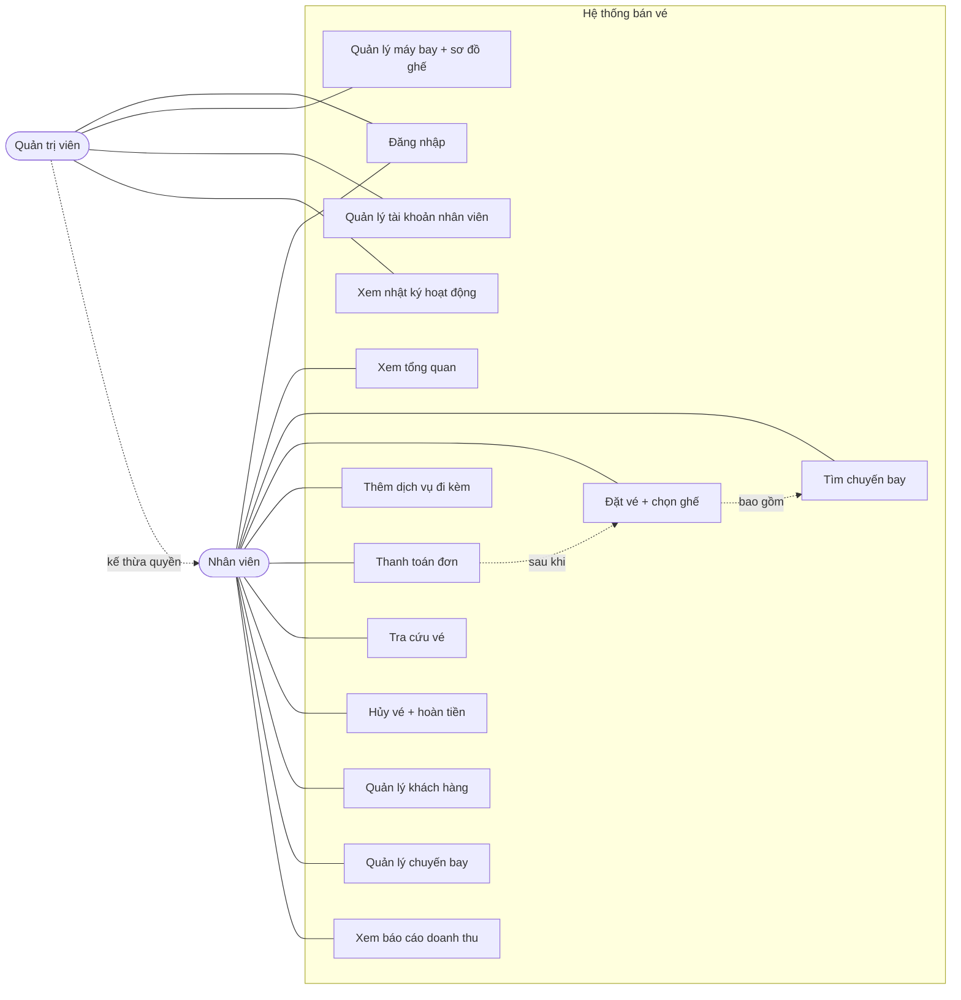

---

## 5. Quy trình bán vé từ đầu đến cuối

### 5.1 Luồng nghiệp vụ

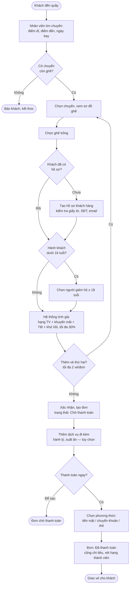

### 5.2 Trình tự xử lý giữa các lớp khi đặt vé

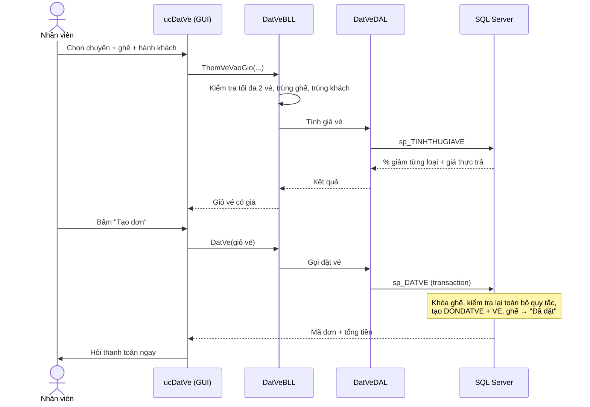

> Quy tắc được kiểm tra **hai lần**: ở BLL (báo lỗi sớm, thân thiện) và trong stored procedure (đảm bảo đúng ngay cả khi hai quầy đặt cùng lúc).

---

## 6. Quy tắc tính giá và giảm giá

**Giá thực trả = Giá gốc × (1 − Tổng % giảm)**, trong đó tổng % giảm là tổng 4 loại dưới đây nhưng **không vượt quá 30%**.

| Loại giảm | Mức | Điều kiện |
|---|---|---|
| Hạng thành viên | 0 / 8 / 10 / 12 / 15% | Theo hạng hiện tại của hành khách (xem mục 9) |
| Ưu đãi Tết | 10% | Mua vé trong **tháng 1–3**; mỗi khách tối đa **2 vé Tết/năm**; không chọn qua danh sách khuyến mãi |
| Khứ hồi | 10% | Đơn có **đúng 2 vé cùng một hành khách**, tuyến bay **đảo chiều** (A→B và B→A) |
| Mã khuyến mãi | Theo mã | Còn hạn, còn lượt, đang hoạt động; có thể có mức giảm tối đa (VNĐ) |

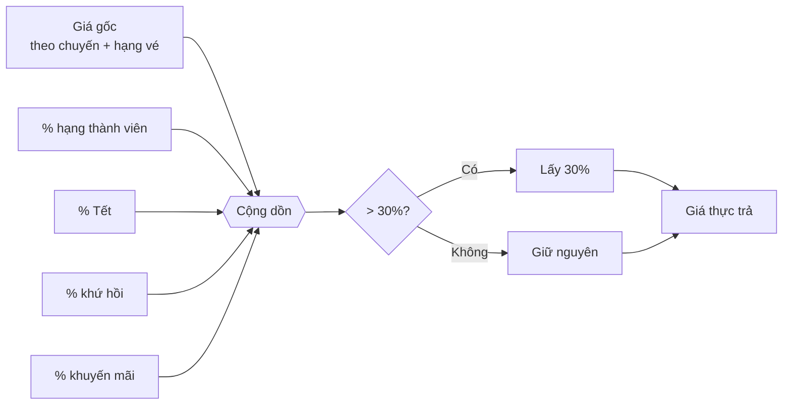

**Ví dụ**: vé Phổ thông 900.000 đ, khách hạng Vàng (10%), mua tháng 2 có ưu đãi Tết (10%), vé khứ hồi (10%), mã khuyến mãi 5% → tổng 35% → **áp 30%** → giá thực trả 630.000 đ.

**Giá gốc mẫu** (đặt khi tạo chuyến bay):

| Tuyến | Phổ thông | PT đặc biệt | Thương gia |
|---|---:|---:|---:|
| Nội địa | 900.000 | 1.500.000 | 2.800.000 |
| Châu Á (NRT, ICN, HKG, SIN) | 2.500.000 | 4.200.000 | 8.500.000 |
| Đường dài (SYD, SVO, MAN) | 6.500.000 | 9.500.000 | 18.000.000 |

**Các ràng buộc khác khi đặt vé**

- Mỗi đơn tối đa **2 vé**.
- Một hành khách **không** có 2 vé trên cùng một chuyến.
- Hành khách **dưới 16 tuổi** phải có **người giám hộ từ 18 tuổi**.
- Chỉ đặt được chuyến **"Đang mở bán"** và **chưa khởi hành**; ghế phải **"Trống"**.
- **Dịch vụ đi kèm** (hành lý ký gửi thêm, suất ăn, nước uống…) tính riêng, không được giảm giá.

---

## 7. Thanh toán

Số tiền thu luôn **bằng đúng tổng thanh toán của đơn** (không thu một phần). Chỉ thanh toán được đơn đang **"Chờ thanh toán"**.

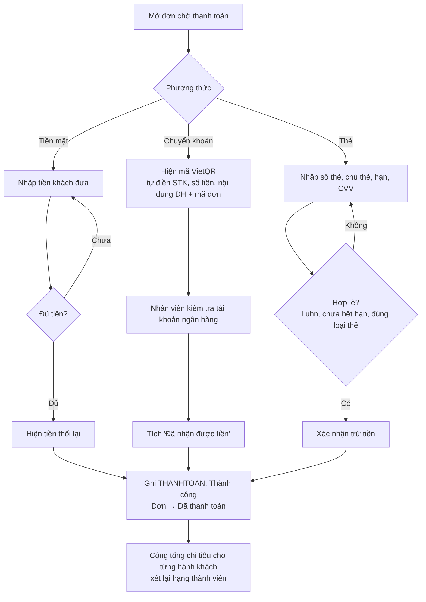

| Phương thức | Lưu vào ghi chú thanh toán |
|---|---|
| Tiền mặt | Tiền khách đưa, tiền thối |
| Chuyển khoản | Ngân hàng, số tài khoản, nội dung chuyển khoản (`DH12`) |
| Thẻ | Loại thẻ + **4 số cuối** + tên chủ thẻ (không lưu số thẻ đầy đủ, hạn, CVV) |

> **Lưu ý demo**: tài khoản nhận chuyển khoản là tài khoản mẫu, đổi trong `TaiKhoanNhanTien` ở [BLL/ThanhToanBLL.cs](BLL/ThanhToanBLL.cs). Thanh toán thẻ là mô phỏng, không kết nối máy POS.

---

## 8. Hủy vé và hoàn tiền

**Phí hủy** tính theo thời gian còn lại trước giờ khởi hành, trên **giá thực trả** của vé:

| Thời gian còn lại | Phí hủy | Tiền hoàn |
|---|---:|---:|
| Từ 72 giờ trở lên | 10% | 90% |
| Từ 24 đến dưới 72 giờ | 20% | 80% |
| Dưới 24 giờ | 30% | 70% |

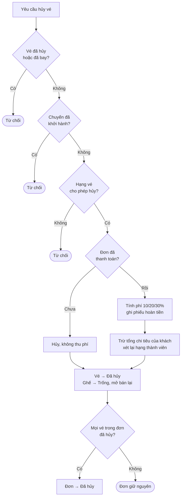

---

## 9. Hạng thành viên

Hạng tính theo **tổng chi tiêu** (tiền vé + dịch vụ đã thanh toán, trừ tiền đã hoàn).

| Hạng | Tổng chi tiêu từ | Giảm giá vé |
|---|---:|---:|
| Thành viên | 0 đ | 0% |
| Bạc | 20.000.000 đ | 8% |
| Vàng | 40.000.000 đ | 10% |
| Bạch Kim | 50.000.000 đ | 12% |
| Kim Cương | 100.000.000 đ | 15% |

- Hạng có **hiệu lực 1 năm** kể từ giao dịch đầu tiên. Hết hạn thì khách về hạng **Thành viên**.
- Hạng được xét lại tự động sau mỗi lần **thanh toán** và **hủy vé có hoàn tiền**.

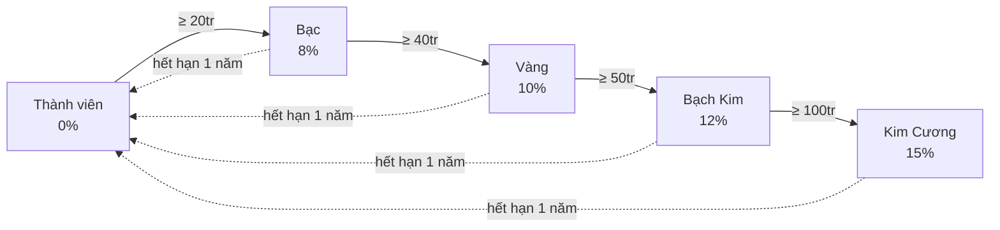

---

## 10. Vòng đời trạng thái

### Đơn đặt vé

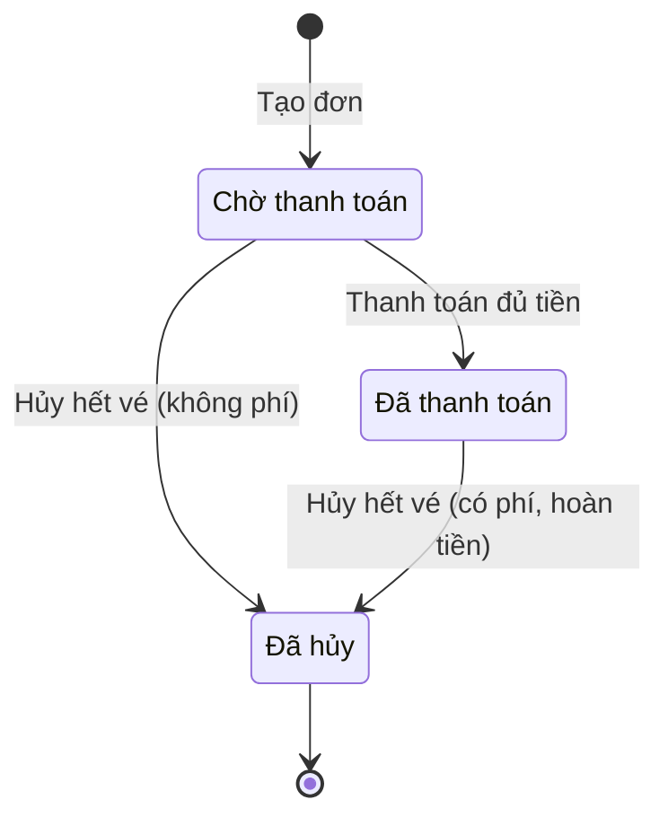

### Vé và ghế trên chuyến bay

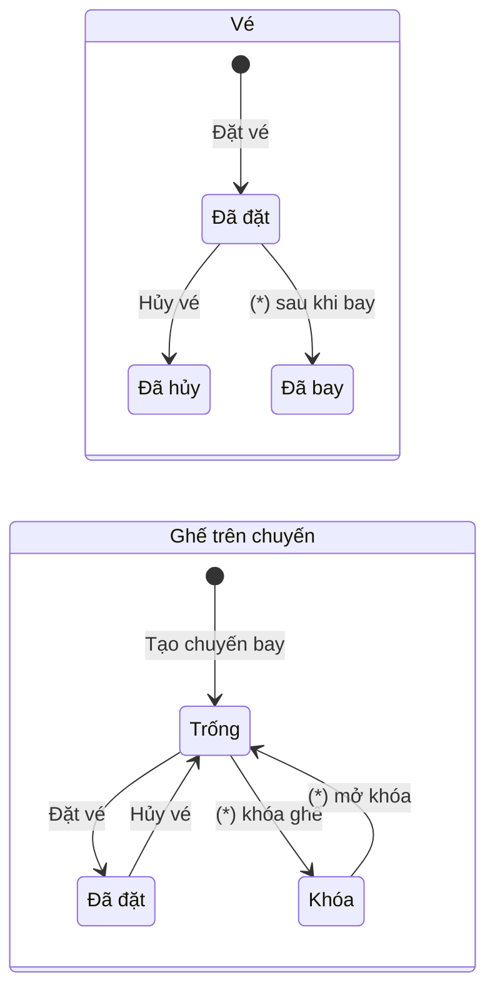

> (*) Trạng thái **có trong CSDL** nhưng **chưa có chức năng** trên giao diện: vé chưa tự chuyển sang "Đã bay", và chưa có màn hình khóa/mở khóa ghế. Vé đã khởi hành vẫn không hủy được vì hệ thống kiểm tra giờ khởi hành.

### Chuyến bay

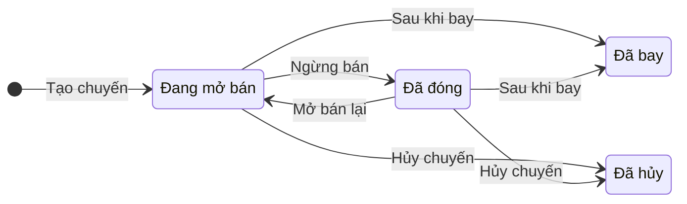

Trạng thái chuyến bay do nhân viên **đổi thủ công** ở màn hình Chuyến bay. Sơ đồ trên là luồng nên theo; hiện hệ thống chưa chặn các bước chuyển khác. Chỉ chuyến **"Đang mở bán"** và **chưa khởi hành** mới bán được vé.

---

## 11. Sơ đồ ghế máy bay

Ghế chia hạng **theo hàng**, giống máy bay thật (kiểu Airbus A321): Thương gia ở phía mũi, Phổ thông ở phía đuôi.

```text
              MŨI MÁY BAY
        ┌─────────────────────────┐
        │      THƯƠNG GIA (2-2)   │
   1    │   A   C   │   D   F     │
   2    │   A   C   │   D   F     │
        │  PHỔ THÔNG ĐẶC BIỆT 3-3 │
   3    │  A  B  C  │  D  E  F    │
   4    │  A  B  C  │  D  E  F    │
        │    PHỔ THÔNG (3-3)      │
   5    │  A  B  C  │  D  E  F    │
  ...   │          ...            │
  10    │  A  B  C  │  D  E  F    │
        └─────────────────────────┘
              ĐUÔI MÁY BAY
```

| Hạng | Hàng (mặc định) | Bố trí | Số ghế | Hành lý xách tay / ký gửi |
|---|---|---|---:|---|
| Thương gia | 1–2 | 2-2 (A C \| D F) | 8 | 18 kg / 32 kg |
| Phổ thông đặc biệt | 3–4 | 3-3 | 12 | 10 kg / 32 kg |
| Phổ thông | 5–10 | 3-3 | 36 | 7 kg / 23 kg |
| **Tổng** | | | **56** | |

Khi **thêm máy bay mới**, quản trị viên nhập số hàng cho từng hạng. Hệ thống tự sinh ghế, tối đa 60 hàng, ít nhất 1 hàng Phổ thông. Khi **tạo chuyến bay**, hệ thống tự sao chép toàn bộ ghế của máy bay thành ghế "Trống" của chuyến và tạo bảng giá 3 hạng.

---

## 12. Quy tắc nhập liệu khách hàng

| Trường | Quy tắc | Ví dụ hợp lệ |
|---|---|---|
| Họ tên | Chữ cái và khoảng trắng, cho phép `'` `-` (tên nước ngoài), 2–100 ký tự | `Nguyễn Văn An`, `Jean-Paul O'Neil` |
| CCCD | Đúng 12 chữ số | `079079000001` |
| Hộ chiếu | 6–9 ký tự chữ in hoa/số, có ít nhất 1 số | `C1234567` |
| Giấy khai sinh | Chỉ cho hành khách **dưới 14 tuổi** | `125/2018` |
| SĐT Việt Nam | 10 số, đầu 03/05/07/08/09 (hoặc `+84` + 9 số); lưu thống nhất dạng `+84…` | `0912345678` → `+84912345678` |
| SĐT nước ngoài | `+` mã quốc gia, tổng 8–15 chữ số | `+14155552671` |
| Email | Dạng `ten@tenmien.duoi`, lưu chữ thường | `nguyenvana@gmail.com` |
| Ngày sinh | Không ở tương lai | |

Số giấy tờ là **duy nhất**: mỗi giấy tờ chỉ gắn với một khách hàng. Quy tắc nằm ở [BLL/KiemTraDuLieu.cs](BLL/KiemTraDuLieu.cs).

---

## 13. Mô hình dữ liệu (ERD)

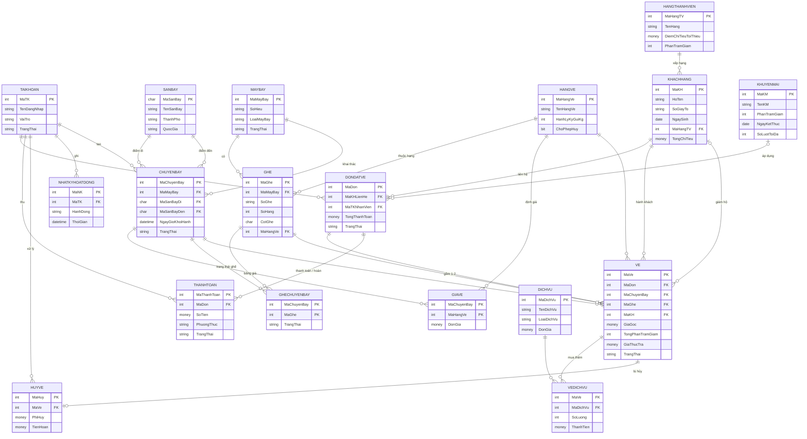

**Nhóm bảng**

| Nhóm | Bảng | Vai trò |
|---|---|---|
| Danh mục | `SANBAY`, `HANGVE`, `HANGTHANHVIEN`, `DICHVU`, `KHUYENMAI` | Dữ liệu ít thay đổi, cấu hình nghiệp vụ |
| Đội bay | `MAYBAY`, `GHE` | Máy bay và sơ đồ ghế cố định của từng máy bay |
| Khai thác | `CHUYENBAY`, `GIAVE`, `GHECHUYENBAY` | Chuyến bay, giá theo hạng, trạng thái từng ghế trên chuyến |
| Giao dịch | `DONDATVE`, `VE`, `VEDICHVU`, `THANHTOAN`, `HUYVE` | Bán vé, thu tiền, hủy và hoàn |
| Con người | `KHACHHANG`, `TAIKHOAN` | Khách hàng và nhân viên |
| Kiểm soát | `NHATKYHOATDONG` | Nhật ký thao tác |

**Đối tượng phía CSDL**

| Loại | Tên | Dùng cho |
|---|---|---|
| Thủ tục | `sp_DANGNHAP` | Đăng nhập |
| | `sp_TIMKIEMCHUYENBAY` | Tìm chuyến theo điểm đi/đến/ngày |
| | `sp_TAOCHUYENBAY` | Tạo chuyến + bảng giá + ghế trống |
| | `sp_TAOMAYBAYVAGHE` | Tạo máy bay + sinh ghế theo hạng |
| | `sp_TINHTHUGIAVE` | Tính thử giá một vé (xem trước) |
| | `sp_DATVE` | Tạo đơn và vé (transaction) |
| | `sp_THANHTOANDON` | Thanh toán, cộng chi tiêu, xét hạng |
| | `sp_HUYVE` | Hủy vé, tính phí, hoàn tiền |
| | `sp_TRACUUVE` | Tra cứu vé theo mã vé / mã chuyến bay / số giấy tờ |
| | `sp_XETHANGTHANHVIEN` | Xét lại hạng một khách |
| | `sp_THONGKEDASHBOARD` | Số liệu trang tổng quan |
| | `sp_LAYDULIEUCOMBOBOX` | Dữ liệu cho các ô chọn |
| View | `V_CHUYENBAYCHITIET`, `V_VECHITIET`, `V_SODOGHECHUYENBAY` | Dữ liệu hiển thị chuyến, vé, sơ đồ ghế |
| | `V_DOANHTHUTHEOTHANG`, `V_DOANHTHUTHEOCHUYENBAY` | Báo cáo doanh thu |
| | `V_KHACHHANGTHANHVIEN`, `V_LICHSUGIAODICH` | Khách hàng và lịch sử giao dịch |
| Trigger | `trg_GHINHATKY` | Tự ghi nhật ký khi thêm/sửa/xóa tài khoản |

---

## 14. Kiến trúc phần mềm

Ứng dụng chia **3 lớp**. Mỗi lớp chỉ gọi lớp ngay dưới nó.

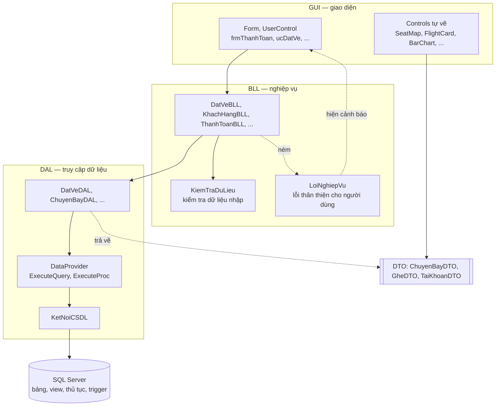

**Xử lý lỗi**

- **Lỗi nghiệp vụ** (BLL ném `LoiNghiepVu`, hoặc thủ tục SQL `THROW` mã ≥ 50000): hiện hộp cảnh báo với nội dung dễ hiểu.
- **Lỗi hệ thống** (mất kết nối, lỗi bất ngờ): hiện hộp lỗi.

---

## 15. Màn hình và chức năng

| Menu | Màn hình | Chức năng chính | Quyền |
|---|---|---|---|
| Tổng quan | `ucTongQuan` | Doanh thu, số vé, biểu đồ 12 tháng, chuyến sắp bay | Tất cả |
| Đặt vé | `ucDatVe` | 3 bước: chọn chuyến → chọn ghế + hành khách → xác nhận | Tất cả |
| Đơn đặt vé | `ucDonDatVe` | Xem đơn, thêm dịch vụ, thanh toán, hủy vé | Tất cả |
| Tra cứu / hủy vé | `ucTraCuuVe` | Tìm vé theo mã vé, mã chuyến bay, số giấy tờ; hủy vé | Tất cả |
| Khách hàng | `ucKhachHang` | Thêm/sửa khách, xem hạng thành viên | Tất cả |
| Chuyến bay | `ucChuyenBay` | Tạo chuyến, đổi trạng thái | Tất cả |
| Báo cáo | `ucBaoCao` | Doanh thu theo tháng, theo chuyến, theo nhân viên | Tất cả |
| Máy bay | `ucMayBay` | Thêm máy bay, cấu hình số hàng ghế theo hạng | Quản trị |
| Tài khoản | `ucTaiKhoan` | Thêm nhân viên, khóa/mở khóa | Quản trị |
| Nhật ký | `ucNhatKy` | 500 thao tác gần nhất | Quản trị |

---

## 16. Cấu trúc thư mục

```text
QuanLyBanVeMayBay/
├── Database/
│   └── QuanLyBanVeMayBay.sql     Script tạo bảng, view, thủ tục, trigger, dữ liệu mẫu
├── GUI/                          Form và UserControl (mỗi màn hình 1 cặp .cs + .Designer.cs)
├── Controls/                     Control tự vẽ: SeatMap, FlightCard, BarChart, RoundedButton, ...
├── BLL/                          Nghiệp vụ, kiểm tra dữ liệu, thanh toán
├── DAL/                          Câu lệnh SQL, gọi thủ tục; KetNoiCSDL + DataProvider
├── DTO/                          Đối tượng dữ liệu truyền giữa các lớp
├── Utils/                        Giao diện chung (AppTheme), định dạng tiền/ngày, hộp thoại
├── Program.cs
├── QuanLyBanVeMayBay.csproj      .NET 8 WinForms; thư viện: Microsoft.Data.SqlClient, QRCoder
└── QuanLyBanVeMayBay.slnx
```
